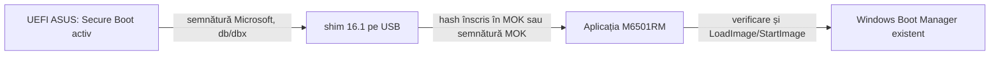

> Arhivă a laboratorului original. Datele, aprobările și stările de boot descrise aici sunt istorice. Unele fișiere brute menționate sunt păstrate doar local. Pentru utilizarea copiei publice, începe cu [ghidul actual](INSTALL.md).

# M6501RM: laborator FP16/BF16 cu Secure Boot

**FP16/BF16/TF32 verificate fizic, cu Secure Boot activ.** MOK este înrolat, RUN0000 confirmă SS1=8 după FLR, iar TF32 a crescut la **23,467 TFLOPS (+73,35% față de SS0-only; +69,25% față de stock)**. Testul TF32 de 5 minute a trecut la 22,551 TFLOPS mediană, maximum 85°C, fără erori numerice sau limitare termică raportată. Noua variantă este configurată prima; vechea pornire și Windows Boot Manager sunt păstrate. [Raport fizic](results/automatic-tf32-physical-20261026-193847/REPORT.md), [utilizare și revenire](docs/START-TF32-AUTOMATIC.md). Notele următoare sunt istorice.

**Actualizare instalată: pornire automată FP16/BF16 + experiment TF32, MOK nou încă neînrolat.** La cererea utilizatorului, intrarea nouă este prima, iar vechea pornire automată și Windows Boot Manager sunt păstrate. Nu s-a făcut restart și SS1=8 nu a fost încă aplicat pe GPU. [Pașii pentru următoarea pornire](docs/START-TF32-AUTOMATIC.md).

**Actualizare TF32, 26 octombrie: diagnostic trecut, candidat SS1 separat pregătit și neaplicat.** CUPTI confirmă kernelul Tensor Core TF32; trei math-mode-uri cuBLAS păstrează același kernel și aproximativ 13,4–13,5 TFLOPS. Candidatul manual SS0+SS1 a trecut testele pe ROM salvat și shim/MOK în VM, dar efectul TF32 pe acest laptop nu este încă validat. Pachetul intern folosește `EFI/M6501TF32`, separat de unlockul automat actual. Instalarea, noul hash MOK și testul fizic așteaptă acordul utilizatorului. [Investigație și cod](docs/TF32-INVESTIGATION.md), [raport](results/tf32-investigation-20261026/REPORT.md).

**Cel mai recent rezultat: PASS, 20 de minute în Performance după restart.** Deblocarea automată internă `RUN0001` și Secure Boot au trecut verificarea. Sarcină lungă: **40,705 TFLOPS FP16 / 41,887 BF16**, 41.600 GEMM, toate cele 416 rezultate complete corecte și zero evenimente driver/hardware în această pornire la verificarea finală. Benchmarkurile scurte înainte/după au rămas la aproximativ 42,4/43,7 TFLOPS, diferență sub 0,2%. Temperatura maximă 85°C, fără thermal slowdown raportat; **limitarea dominantă este puterea**, SW Power Cap în 98,33% din eșantioanele active. Fără prag artificial sau pauze termice. [Raport final](results/long-current-state-20261026-115633/REPORT.md), [stare și instrucțiuni](docs/START-INTERNAL-AUTOMATIC-AUTHORIZED.md), [investigația persistenței](docs/PERSISTENCE-INVESTIGATION.md). Paragrafele următoare păstrează istoricul bootului anterior; persistența după idle/sleep rămâne separată de validarea în sarcină.

**Pornirea automată internă este instalată, MOK este înrolat, iar tranzacția RUN0000 și Secure Boot au trecut verificarea fizică.** Nu este necesar USB sau tasta U. La cererea utilizatorului, testul lung din 26 octombrie a fost executat **fără restart**, în sesiunea de după Modern Standby. Sarcina continuă s-a oprit la 82°C după 99,516 secunde; varianta cu pauze s-a oprit la același prag după **16 min 28 s**, cu 7 min 27 s timp CUDA efectiv. Mediane în blocurile active: **21,807 TFLOPS FP16 / 22,358 BF16**. Toate cele 337 de rezultate complete verificate sunt corecte; zero evenimente hardware noi în timpul testului. Existau cinci avertismente corectate pe portul GPU anterior sarcinii. **Cele 20 de minute nu au fost completate; sporul de performanță deblocat nu este confirmat în sesiunea actuală.** [Raportul efectiv](results/long-current-state-20261026-111558/REPORT.md), [starea curentă](docs/START-INTERNAL-AUTOMATIC-AUTHORIZED.md), [metoda](docs/LONG-BENCHMARK.md). Seria veche B3/A4 a fost înlocuită de automatizare.

Anterior, două porniri manuale cu unlock au reușit pe ASUS M6501RM.313, RTX 3060 Laptop 2520 A1 / subsystem 1043:1313, driver 580.97. În B1: FP16 **42,710 TFLOPS (+57,00%)**, BF16 **44,726 (+61,50%)**. În B2: **42,953 (+57,89%) / 43,966 (+58,76%)**, cu ieșiri complete identice la nivel de hash. Controalele normale A2 și A3 au revenit la referință. Vezi [B1](docs/UNLOCK-RESULT-v3.md), [A2](docs/NORMAL-RETURN-RESULT-v3.md), [B2](docs/UNLOCK-B2-RESULT-v3.md) și [A3](docs/NORMAL-RETURN-A3-RESULT-v3.md).

Benchmarkul de referință a fost executat primul, în Windows, pe driverul 580.97 și VBIOS 94.06.38.00.38. Proiectul nu a schimbat frecvențe, limite de putere, BIOS sau VBIOS. După acord a fost înrolat hashul PROBE în MOK; PK/KEK/db/dbx au rămas identice. În acea etapă USB, Windows Boot Manager a rămas identic și primul. În instalarea internă ulterioară este al doilea, după intrarea automată aprobată. Mediul Python și compilatorul sunt locale acestui folder.

| Mod | Mediana ms/GEMM | TFLOPS dense |
|---|---:|---:|
| FP16 → FP32 | 40,417 | 27,204 |
| BF16 → FP32 | 39,702 | 27,694 |
| TF32 → FP32 | 79,300 | 13,865 |
| FP32 de control | 117,680 | 9,343 |

Matrice 8192×8192, 4 secunde de încălzire/mod, 5 eșantioane × 10 GEMM, cronometrare cu evenimente CUDA. FP16/BF16 folosesc acumulare și ieșire FP32, cu reducerea de precizie intermediară interzisă. Toate ieșirile au fost finite; verificarea a 2.048 de elemente/mod față de referințe CPU FP64 a trecut. Hashurile acoperă intrările și întreaga ieșire. Rezultatele brute și telemetria sunt în [results/baseline-2026-10-25.json](results/baseline-2026-10-25.json). Aceste rezultate singure nu demonstrează starea selectorilor.

Implementarea și limitele

Nucleul UEFI este derivat din craftingmod/rtx30-unlock la commit fixat, cu o adaptare locală care scrie **SS0=0x88888888 și păstrează SS1 citit în bootul curent**. Valorile SS0/SS1, BAR-urile și FWSEC ale altor laptopuri nu sunt folosite ca profil pentru acesta. ROM-ul live trebuie să coincidă cu un hash încorporat în executabil după analiză. Driverul Windows rămâne cel existent.

| Executabil în `build/` | Comportament |
|---|---|
| `M6501-PROBE.EFI` | Variabile Secure Boot, identitate SMBIOS/PCI, proprietarul GOP; fără acces MMIO sau scrieri GPU |
| `M6501-HANDOFF.EFI` | Aceleași verificări și pornirea Windows Boot Manager existent, fără deblocare |
| `M6501-CAPTURE.EFI` | După tasta P: exclusivitate PCI, activare temporară MEMORY dacă este necesară, citire PROM/stare rece, restaurare; fără firmware GPU, DMA sau FLR |
| `M6501-UNLOCK-CANDIDATE.EFI` | Copia veche din `build/` rămâne blocată. Candidatul v3 separat a trecut B1 și B2: SS0 schimbat, SS1 păstrat, un FLR, DMA/PCI restaurate și Windows pornit. Seria manuală B3/A4 a fost înlocuită de pornirea automată internă |

Adaptorul cere SecureBoot=1, SetupMode=0, validare shim activă dacă MokSBStateRT există, BIOS și model SMBIOS exacte, BDF `0000:01:00.0`, identitatea/subsystem/revizia exacte și GOP fizic pe AMD `1002:1681`. Refuză un GOP NVIDIA, proprietari PCI activi, BME activ, stare D3, MSI activ, BAR/punți necorespunzătoare, WPR2 deja activ ori firmware incompatibil. Nu deconectează drivere UEFI pentru a forța trecerea verificărilor.

Lanțul propus este:



shim și MokManager sunt extrase din pachete Debian fixate și verificate SHA-256. Aplicația locală se numește `grubx64.efi` pe USB pentru a fi încărcată de shim; **nu este GRUB**. Are secțiune SBAT proprie, NX, relocări și nu importă DLL-uri Windows. `fbx64.efi`/fallback.efi sunt excluse, pentru a evita mecanismul de creare automată de intrări boot.

Înrolarea unui hash MOK este metoda inițială propusă: autorizează exact executabilul respectiv, fără o cheie privată nouă. **Modifică persistent lista de încredere shim, până la eliminarea intrării. Necesită acord separat.** Nu schimbă PK/KEK/db/dbx. Un executabil recompilat necesită un hash nou. Varianta cu certificat MOK și `sbsign` este descrisă în [docs/RESEARCH.md](docs/RESEARCH.md).

Prezența certificatelor Microsoft/Canonical/ASUS în db nu autorizează automat aplicația noastră. Acceptarea shim depinde și de dbx/politicile SBAT efective. Un shim recompilat local nu moștenește semnătura Microsoft. Nu folosim dezactivarea validării shim sau un bootloader vulnerabil pentru ocolirea Secure Boot.

Compilare reproductibilă, numai fișiere locale

Din acest folder, în PowerShell:

```powershell
python -m venv .venv
.\.venv\Scripts\python.exe -m pip install -r bench/requirements.txt -r tools/requirements.txt
.\.venv\Scripts\python.exe tools/prepare.py bootstrap
.\.venv\Scripts\python.exe tools/prepare.py shim
.\.venv\Scripts\python.exe tools/prepare.py firmware
.\.venv\Scripts\python.exe tools/build.py
.\.venv\Scripts\python.exe tools/test.py
```

Dependențe: Windows x64, Python 3.13, Git, spațiu pentru arhivele NVIDIA și compilatorul portabil. Nu este necesar un CUDA Toolkit complet, Bun, WSL sau Windows SDK. `config/sources.lock.json` fixează sursele, compilatorul și pachetele shim. Extracția firmware-ului nu execută instalatoare NVIDIA. Un hash greșit sau un checkout modificat oprește pregătirea.

`config/board.pending.json` și candidatul vechi rămân blocate. Candidatul v3 din `build/candidate-20261025-v3/`, cu `config/board.reviewed.json`, leagă exact chipul, ROM-ul și valorile fuse. După testele simulate a primit acord distinct și **a trecut prima execuție fizică în RUN06**, urmată de benchmark și verificarea trustului. [Candidatul v3](docs/UNLOCK-CANDIDATE-v3.md) păstrează propunerea și hashurile aprobate; [rezultatul fizic](docs/UNLOCK-RESULT-v3.md) este starea curentă. Acordul pentru o încercare este consumat.

Pachete USB pregătite pentru revizuire

Pachetele locale sunt în **`build/release-20261025-v3/USB-*`**; v2 rămâne arhiva etapelor anterioare. Stickul SanDisk Ultra F:, FAT32, eticheta **M6501PROBE**, conține **candidatul v3**, copiat și înrolat după acord. Cele 20 de fișiere au fost recitite; ROM-ul și cele șase loguri existente au fost păstrate. Backup CAPTURE: `results/unlock-deployment-20261025-211730/USB-CAPTURE-BACKUP/`. Primul unlock a trecut în RUN06, cu dovezi arhivate în `results/physical-unlock-20261025-212306/`. Nu se repetă captura sau unlock automat; urmează controlul de revenire la boot normal.

PROBE și HANDOFF au fost înrolate și validate fizic înaintea acestei actualizări; Windows și benchmarkul au funcționat. Controlul Windows direct fără USB a reprodus avertismentul Realtek. Inventarul partițiilor interne a rămas identic după pregătirea inițială. Raportul formatarei autorizate este `results/usb-probe-preparation-20261025-184136/result.json`. Pentru recrearea unui pachet local se folosește un nume de folder nou:

```powershell
.\.venv\Scripts\python.exe tools/stage_usb.py --mode probe --output build/USB-PROBE-NEW
.\.venv\Scripts\python.exe tools/stage_usb.py --mode handoff --output build/USB-HANDOFF-NEW
.\.venv\Scripts\python.exe tools/stage_usb.py --mode capture --output build/USB-CAPTURE-NEW
.\.venv\Scripts\python.exe tools/stage_usb.py --mode candidate --output build/USB-CANDIDATE-NEW
```

Pregătirea refuză o destinație în afara folderului local `build/` și nu suprascrie foldere existente. Conținutul include manifest cu hashurile fiecărui executabil. Pentru testarea viitoare se folosește un USB FAT32 separat, ales din meniul temporar ASUS; partiția EFI Windows rămâne intactă.

Verificare și pasul următor

Au trecut testele locale ale adaptorului, validării PCI, SHA-256, formatului PE și 20 de scenarii de tranzacție cu servicii UEFI simulate. PROBE, HANDOFF și CAPTURE nu conțin rutinele GPU de scriere MMIO/DMA/FLR în harta finală de linkare. ROM-ul sintetic din teste nu este ROM-ul laptopului și nu este inclus în pachetele USB.

**PROBE a trecut fizic pe ASUS:** patru loguri au `EXIT status=0 GPU_MMIO_writes=0`, SecureBoot=1/SetupMode=0, identitate exactă și GOP AMD independent. Hashul exact PROBE este prezent în MokListRT după înrolarea aprobată. PK/KEK/db/dbx sunt identice cu exportul anterior, iar intrarea Windows Boot Manager a rămas identică și prima în ordine. Inventarul firmware diferă: afișează acum intrarea concretă SanDisk, în locul intrărilor generice anterioare; nu pretindem că inventarul complet de boot este neschimbat. [Rezultatul PROBE](docs/PROBE-RESULT.md) conține dovezile.

**HANDOFF a trecut funcțional pe ASUS:** Windows a pornit prin shim/HANDOFF, Secure Boot este activ, ambele hashuri aprobate sunt în MOK, iar exporturile de după HANDOFF confirmă PK/KEK/db/dbx și intrarea Windows Boot Manager identice. Benchmarkul de control are ieșiri integral identice și diferență maximă de 0,315%. Un boot Windows direct fără USB a reprodus avertismentul WHEA 17 corectat al portului Ethernet Realtek; acesta nu este specific rutei HANDOFF, iar cauza rămâne neconfirmată. [Rezultatul HANDOFF](docs/HANDOFF-RESULT.md) include dovezile și limitele. **CAPTURE a trecut ulterior:** ROM complet, restaurare PCI confirmată, control GEMM cu abatere maximă 0,256% și ieșiri identice. Colectarea UAC reluată confirmă și hashul CAPTURE în MOK, trustul și Windows Boot Manager neschimbate; vezi [rezultatul CAPTURE](docs/CAPTURE-RESULT.md).

**Primul unlock fizic v3 a trecut:** execuție FWSEC/Booter, SS0-only, un FLR, DMA/PCI restaurate și handoff Windows cu driver 580.97. FP16/BF16 au câștigat 57,00%/61,50%, cu ieșiri identice. **Rămân nevalidate:** revenirea după oprire completă, repetabilitatea între booturi, idle/sleep/resume, aplicațiile reale și stabilitatea de durată. Cauza avertismentului corectat Realtek rămâne neconfirmată. Vezi [rezultatul complet](docs/UNLOCK-RESULT-v3.md) și [controlul de revenire](docs/NORMAL-RETURN-AFTER-UNLOCK.md).

Au trecut și șase verificări în QEMU/OVMF cu accelerare software, fără acces la discurile fizice, GPU, rețea sau variabilele UEFI reale. Un snapshot al certificatelor publice locale a fost folosit în fișierele UEFI ale mașinii virtuale: shim semnat a încărcat aplicația cu SecureBoot=1/SetupMode=0; fișierul modificat, hashul revocat și aplicația fără MOK au fost respinse; verificarea locală a respins Secure Boot oprit în VM. Funcția reală de handoff a pornit o copie a Windows Boot Manager până la eroarea BCD lipsă așteptată în VM. Nicio instalare Windows nu a fost atașată mașinii virtuale. **Aceasta nu validează firmware-ul ASUS sau tranzacția GPU.** Detaliile și reproducerea sunt în [docs/VM-LAB.md](docs/VM-LAB.md), iar rezultatele în [results/vm-validation.json](results/vm-validation.json).

Repetarea benchmarkului în același boot a dat FP16 27,141 și BF16 27,619 TFLOPS; toate modurile au diferit cu mai puțin de 0,3%, cu ieșiri integral identice. Citirea ACPI/SMBIOS prin API Windows a confirmat exact șirurile folosite de adaptor. VFCT conține ROM AMD `1002:1681`, nu NVIDIA. API-ul Windows expune numai primul SSDT dintre cele 25; nu presupunem că am inspectat toate metodele ACPI. Nu am executat AML sau accesat memoria fizică pentru a extrage ROM-ul NVIDIA.

Colectarea administrativă a fost executată prin UAC, la cererea utilizatorului. Exportul complet este în `results/uefi-readonly-20261025-161851/`: SecureBoot=1, SetupMode=0, TPM funcțional și BitLocker dezactivat. `db` conține opt certificate; `dbx` conține 447 de hashuri. Preverificarea locală din `results/trust-audit-20261025/audit.json` confirmă că hashul PE/Authenticode al shimului pregătit nu este în acel dbx și corespunde conținutului semnat în ambele semnături încorporate. Certificatele CA 2011/2023 din imagine sunt și în db. Aceasta nu reprezintă o simulare completă a politicii UEFI/SBAT sau un test de boot. Variabilele shim RT nu sunt expuse în bootul Windows curent; absența lor nu dovedește lipsa unei liste MOK persistente.

Scriptul [Collect-ReadOnly.ps1](scripts/Collect-ReadOnly.ps1) rămâne disponibil pentru repetarea colectării, fără modificări de firmware. După reluarea UAC, exportul `results/uefi-post-capture-20261025-203931/` confirmă toate cele trei hashuri aprobate în MokListRT, SecureBoot=1/SetupMode=0 și trustul platformei/Windows Boot Manager identice. Testul HANDOFF și extragerea PROM-ului complet sunt încheiate.

Procedura etapizată, criteriile de acceptare și recuperarea sunt în [docs/TESTING.md](docs/TESTING.md). Cercetarea și particularitățile ASUS/GA106M sunt în [docs/RESEARCH.md](docs/RESEARCH.md).

Codul derivat și adaptorul sunt GPL-2.0-only; se păstrează [licențele și atribuirea](THIRD_PARTY_NOTICES.md). Firmware-ul NVIDIA are condiții separate.
